  

  
  

<!-- ═══════════════════════════ ABOUT ═══════════════════════════ -->

  

Hey, I'm **DeSynkro**.

Jack of all trades and Linux gamer running CachyOS (Arch btw), I build websites, shoot and edit photos, cut video, and spend far too long in the Linux rabbit hole. Everything I own runs **Linux**.

I self-host what I can, and I tinker with open source until it breaks, then spend too long trying to fix it.

I used to stream and make tutorials full time. These days I work as a tradie, and on my free time help people move to Linux and mod games for fun. If you want to work together or just talk shop, my inbox is open.

  

  

<!-- ═══════════════════════════ PROJECTS ═══════════════════════════ -->

  

<table>
  <tr>
    <td width="50%">
      
    </td>
    <td width="50%">
      
    </td>
  </tr>
  <tr>
    <td width="50%">
      
    </td>
    <td width="50%">
      
    </td>
  </tr>
  <tr>
    <td width="50%">
      
    </td>
    <td width="50%">
      
    </td>
  </tr>
</table>

  <a href="https://github.com/DeSynkro?tab=repositories"><strong>MORE &nbsp;&nbsp;→</strong></a>

<!-- ═══════════════════════════ CONNECT ═══════════════════════════ -->

  

  Thanks you for your time! Get in touch below and I'll get back to you as soon as possible.

    
    
  

  
  

 

  Thank you to everyone who supported me, it means a lot.

   <a href="https://ko-fi.com/desynkro">Ko-Fi</a> | <a href="https://paypal.me/iagorosa97">PayPal</a> 

